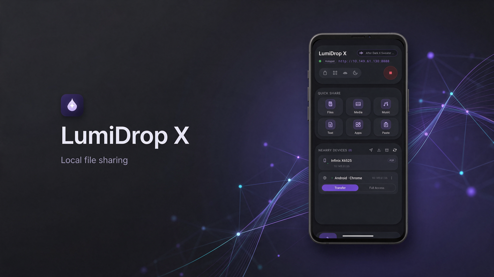
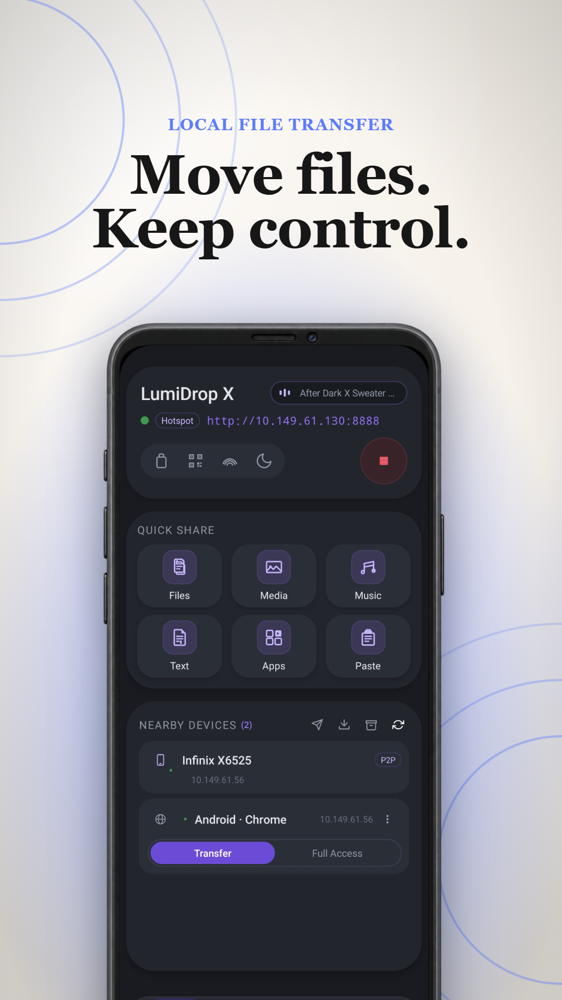
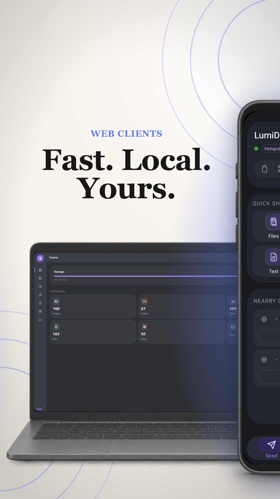
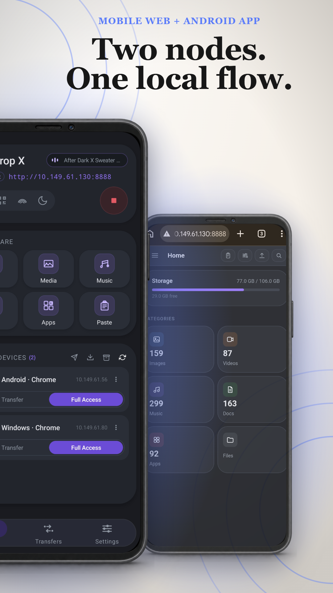
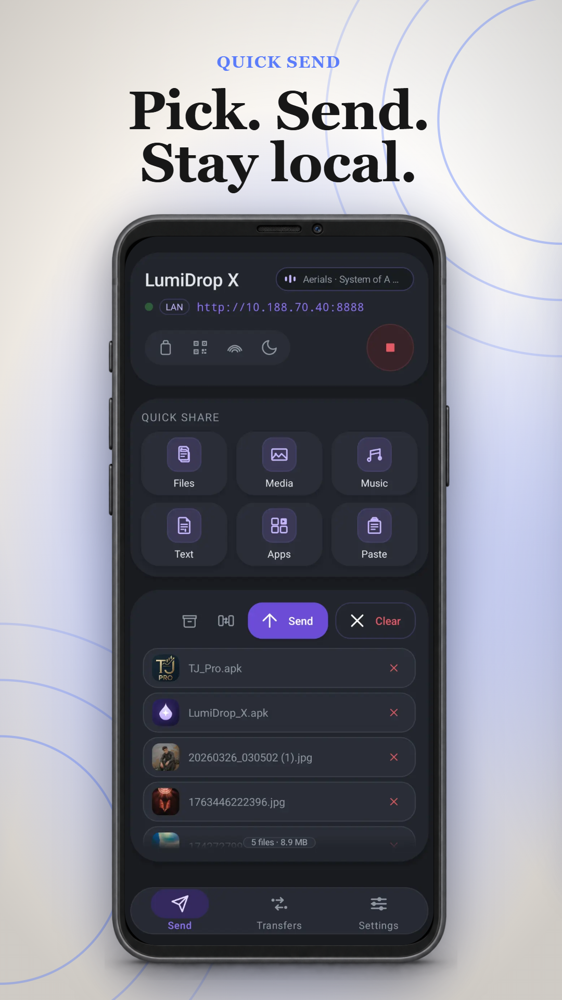

# LumiDrop X

<p align="center"></p>

<p align="center"></p>

LumiDrop X is an Android app for sharing files and text between nearby devices on the same local network.

[](https://developer.android.com/about/versions/lollipop)
[](https://developer.android.com/tools/releases/platforms)
[](https://github.com/0naXim0/LumiDrop-X/releases)

## Features

- Android-to-Android file and text sharing over a local network
- Nearby-device discovery and transfer management
- Resumable transfer handling
- Media and file pickers
- Received-file management
- Embedded web client for browser-based access

## Screenshots

The screenshots below show the main product flows in the same order as the app experience: start a local session, choose content, send it, and access the session from another device.

### 1. Local session and nearby devices

<p align="center">
  
 
  
</p>

<p align="center"><sub>Home and nearby devices · Android App plus mobile/PC web client</sub></p>

### 2. Choose content and review transfers

<p align="center">
  
  

</p>

<p align="center"><sub>File picker · Transfers tab · Queue then Send! or Quick Send IT!</sub></p>

## Download

**[Download the universal APK](https://github.com/0naXim0/LumiDrop-X/releases/latest/download/LumiDrop-X-v1.0.0-universal.apk)** · **[View the release](https://github.com/0naXim0/LumiDrop-X/releases/latest)**

The APK is a universal release build for Android. The release page contains the installable APK and the repository source is available above for inspection and local builds.

## Project details

| Item | Value |
|---|---|
| Application ID | `com.lumidrop.x` |
| Version | `1.0.0` |
| Version code | `89` |
| Minimum Android | API 21 / Android 5.0 |
| Target and compile SDK | API 34 |

## Build locally

Install JDK 17, Android SDK Platform 34, and Android SDK Build Tools 34.0.0.

```bash
./gradlew test
./gradlew assembleDebug
./gradlew assembleRelease
```

For release builds, create an untracked `keystore.properties` from `keystore.properties.example` and use your own signing key. Never commit signing files or passwords.

## Repository structure

- `app/` — Android application module
- `screenshots/overview/` — product screenshots
- `.github/workflows/` — verification workflow
- `CHANGELOG.md` — release history
- `CONTRIBUTING.md` — contribution guidance
- `SECURITY.md` — security reporting guidance

## License

LumiDrop X is released under the [MIT License](LICENSE). You may use, modify, and redistribute the source in accordance with its terms.

## Author

Created by [naXim Labs](https://github.com/0naXim0).
