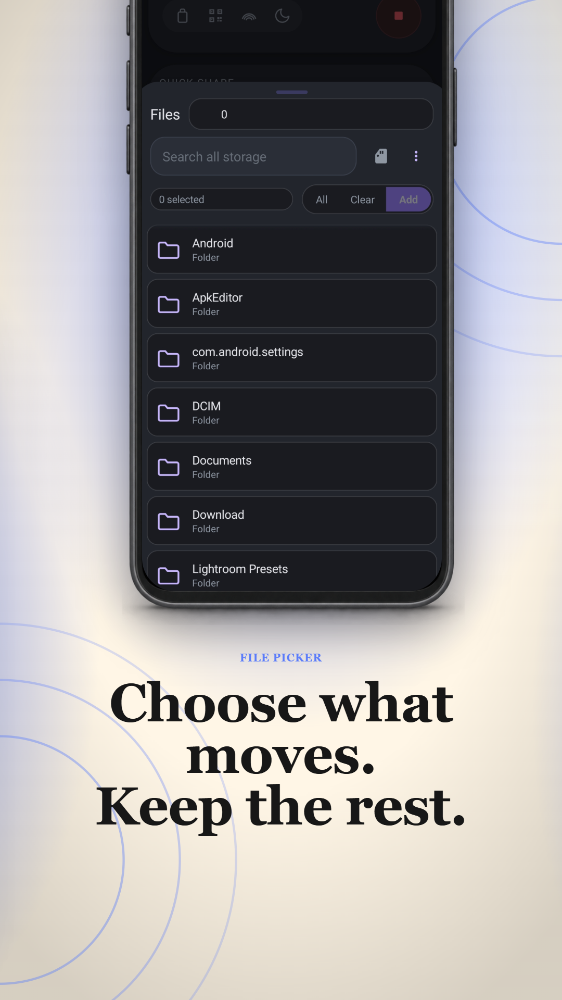
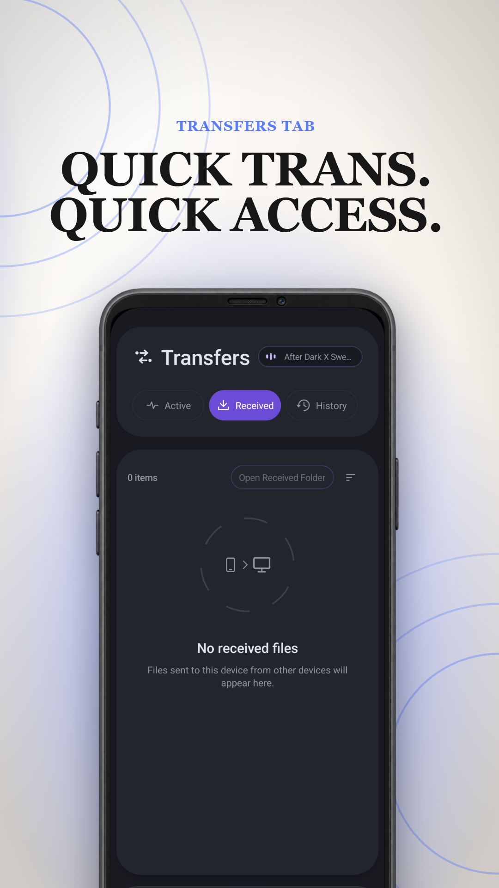
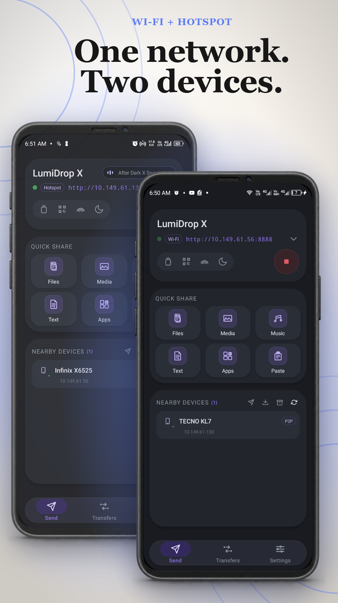

# LumiDrop X

**LumiDrop X** is a native Android app for sharing files and text between nearby devices over a local network. It is designed for direct, private transfers without requiring a cloud account or an external upload service.

[](https://developer.android.com/about/versions/lollipop)
[](https://developer.android.com/tools/releases/platforms)
[](https://github.com/0naXim0/LumiDrop-X/releases)
[](https://github.com/0naXim0/LumiDrop-X/releases/latest/download/LumiDrop-X-v1.0.0-universal.apk)

## Product overview

LumiDrop X combines Android-to-Android transfer support with an embedded web client, device discovery, resumable transfers, media and file pickers, and received-file management. The app is intended for nearby devices connected to the same local network.

## Screenshots

### Start sharing


### Device discovery and transfer flow

| Connected devices | Transfer workspace |
|---|---|
|  |  |

### Additional states

| Two devices | No device connected | Connected device details |
|---|---|---|
|  |  |  |

## Highlights

- Share files and text over a local network.
- Discover nearby devices and manage transfer sessions.
- Resume interrupted transfers and handle larger file workflows.
- Pick media and files through focused Android workflows.
- Review and manage received files.
- Use the embedded web client for flexible sharing scenarios.

## Download

The latest public release includes a universal, release-signed APK for direct installation and an Android App Bundle for Play distribution workflows.

**[Download the universal APK](https://github.com/0naXim0/LumiDrop-X/releases/latest/download/LumiDrop-X-v1.0.0-universal.apk)** · **[View all release assets](https://github.com/0naXim0/LumiDrop-X/releases/latest)**

Before installing an APK, enable installation from the relevant source in Android settings. Verify the downloaded file with the SHA-256 checksum included in the release assets.

## Project details

| Item | Value |
|---|---|
| Application ID | `com.lumidrop.x` |
| Version | `1.0.0` |
| Version code | `89` |
| Minimum Android | API 21 / Android 5.0 |
| Target and compile SDK | API 34 |
| Release build | R8/minified, signed locally with the private release key |

## Build locally

Install JDK 17, Android SDK Platform 34, Android SDK Build Tools 34.0.0, and accept the Android SDK licenses. For a release build, create an untracked `keystore.properties` from `keystore.properties.example` and point it to your privately backed-up signing key.

```bash
./gradlew test
./gradlew assembleDebug
./gradlew assembleRelease
./gradlew bundleRelease
```

The signing configuration accepts either `keystore.properties` values or the `LUMIDROPX_STORE_FILE`, `LUMIDROPX_STORE_PASSWORD`, `LUMIDROPX_KEY_ALIAS`, and `LUMIDROPX_KEY_PASSWORD` environment variables. Never commit real credentials or signing files.

## Repository structure

- `app/` — Android application module and source code
- `screenshots/overview/` — product screenshots used above
- `.github/workflows/` — non-publishing verification workflow
- `CHANGELOG.md` — release history
- `SECURITY.md` — security reporting guidance
- `CONTRIBUTING.md` — contribution guidance

## Verification

The v1.0.0 release passed the supplied unit-test, APK, AAB, and signature verification checks. Runtime testing on a physical device or emulator was not performed in the preparation environment. See the release notes and checksum asset for the exact release artifacts.

## License

No license was supplied with the project, so no license has been inferred. All rights remain with the original copyright holder unless a license is added by the owner.

## Author

Created by [naXim Labs](https://github.com/0naXim0).
